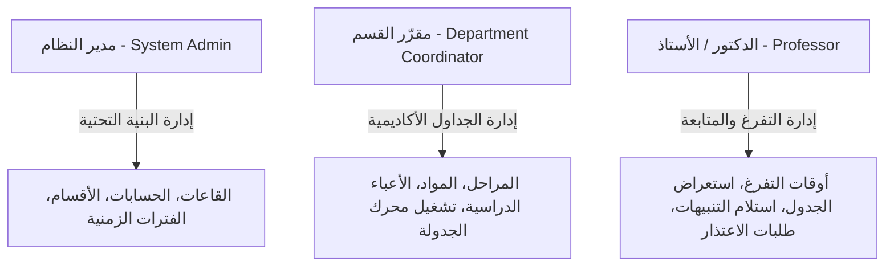
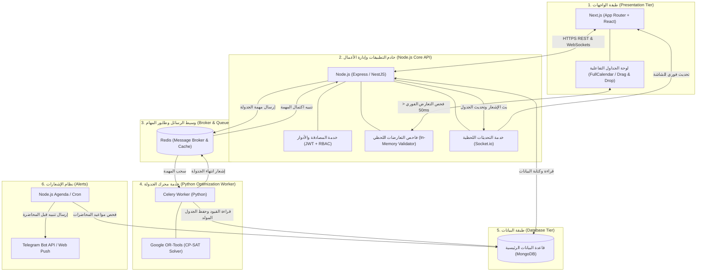
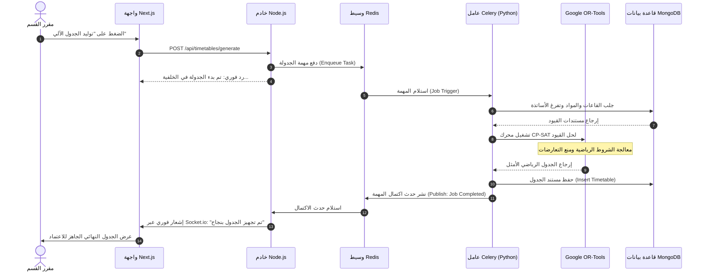
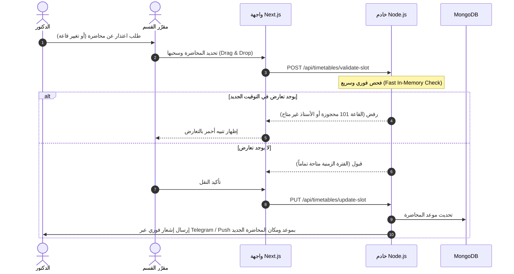

# وثيقة المعمارية البرمجية (Software Architecture Document)
## مشروع: نظام الجدولة الأكاديمية الذكي (Smart Academic Timetable System)

---

## 1. نظرة عامة وبيان المشكلة (System Overview & Problem Statement)

### 1.1 المشكلة الهندسية (The Problem)
يعد إعداد الجداول الدراسية الجامعية من أعقد المسائل الحسابية في علوم الحاسوب، وتصنف رياضياً ضمن مسائل استيفاء الشروط ذات التعقيد العالي (**NP-Hard Constraint Satisfaction Problem - CSP**). 
تتمثل التحديات التشغيلية الرئيسية في:
* **تعارض الموارد الحرج:** تكرار حجز أستاذ أو قاعة لأكثر من محاضرة في نفس الوقت.
* **صعوبة التوزيع اليدوي:** استغراق أسابيع للتنسيق بين المراحل، المواد، القاعات، وأوقات تفرغ الأساتذة.
* **أزمة التعديل الطارئ (Emergency Rescheduling):** صعوبة تعديل أو نقل محاضرة عند حدوث طارئ دون إحداث فوضى في باقي مواعيد الجدول المستقرة.

### 1.2 الحل المقترح (The Solution)
بناء نظام برمجي هجين عالي الأداء يعتمد على معمارية الخدمات المصغرة لتوليد الجداول آلياً بنسبة تعارض 0% باستخدام محرك **Google OR-Tools (CP-SAT)**، مع واجهات تفاعلية وسريعة الاستجابة مبنية بـ **Next.js**، وخادم رئيسي بـ **Node.js**، وقاعدة بيانات مرنة بـ **MongoDB**، وربط مهام المعالجة الرياضية الثقيلة عبر **Redis & Celery**.

---

## 2. نطاق النظام والأدوار (System Scope & RBAC)

النظام مخصص حصرياً للكادر الإداري والأكاديمي (**دكتور وما فوق**) بدون طبقة الطلاب، وينقسم إلى ثلاثة أدوار رئيسية:



### 2.1 مصفوفة الصلاحيات (Access Control Matrix)
| الخاصية / الإجراء | مدير النظام (Admin) | مقرر القسم (Coordinator) | الدكتور (Doctor) |
| :--- | :---: | :---: | :---: |
| إدارة المباني والقاعات والمختبرات | ✅ | 👁️ عرض فقط | ❌ |
| إدارة المستخدمين وتعيين الصلاحيات | ✅ | ❌ | ❌ |
| ضبط إعدادات الفترات وأيام الدوام | ✅ | ❌ | ❌ |
| إدخال المراحل والمواد والخطط الدراسية | ✅ | ✅ | ❌ |
| توزيع المواد على الأساتذة | ❌ | ✅ | ❌ |
| تحديد أوقات التفرغ الأسبوعية | ❌ | ❌ | ✅ |
| تشغيل محرك الجدولة الآلي | ❌ | ✅ | ❌ |
| التعديل اليدوي واعتماد الجدول النهائي | ❌ | ✅ | ❌ |
| استعراض الجدول الشخصي وتصديره | ✅ | ✅ | ✅ |
| استلام تنبيهات المحاضرات والتغييرات | ❌ | ✅ (تنبيهات إدارية) | ✅ (تنبيهات فورية) |

---

## 3. نمذجة القيود الأكاديمية (Constraint Modeling)

### 3.1 القيود الصارمة (Hard Constraints) - غير قابلة للكسر مطلقاً
1. **قيد عدم تعارض الأستاذ (No Professor Clashes):** لا يمكن إسناد أكثر من محاضرة لنفس الأستاذ في نفس الفترة الزمنية.
2. **قيد عدم تعارض القاعة (No Room Clashes):** لا يمكن حجز قاعة أو مختبر لأكثر من محاضرة في نفس الفترة الزمنية.
3. **قيد عدم تعارض المرحلة (No Stage Clashes):** طلاب المرحلة أو الدفعة الواحدة لا يمكن أن يكون لديهم مادتان في نفس الوقت.
4. **قيد ملاءمة نوع القاعة (Room Type Compatibility):** المواد العملية تتطلب مختبرات متوافقة حصراً، والنظرية في قاعات مناسبة.
5. **قيد السعة الاستيعابية (Room Capacity):** سعة القاعة المختارة يجب أن تكون مساوية أو أكبر من عدد طلاب المرحلة.
6. **قيد تفرغ الأستاذ (Doctor Availability):** منع جدولة أي محاضرة في فترات حدد الأستاذ مسبقاً عدم توفره فيها.

### 3.2 القيود المرنة (Soft Constraints) - أهداف تحسين الجودة (Optimization)
1. **تقليل الفجوات الزمنية (Minimizing Idle Gaps):** تقليص فترات الفراغ غير المستغلة بين المحاضرات للأستاذ والطلاب.
2. **توزيع الجهد الأسبوعي (Balanced Workload):** توزيع ساعات المادة على أيام متباعدة وتجنب تكديس المحاضرات في يوم واحد.
3. **تفضيلات الأساتذة (Doctor Preferences):** مراعاة تفضيل الفترات الصباحية أو المسائية للأساتذة قدر الإمكان.

---

## 4. المعمارية التقنية للمشروع (Target Tech Stack Architecture)

تم تصميم معمارية النظام لتجمع بين سرعة واجهات الويب الحية وسلاسة معالجة البيانات، مع عزل المهام الرياضية المعقدة في خدمة معالجة متخصصة:



---

## 5. تفصيل مكونات الحزمة التقنية المختارة (Tech Stack Roles)

### 5.1 الواجهة الأمامية: `Next.js`
* **المسؤولية:** 
  * لوحات تحكم عصرية وسريعة (Admin & Coordinator & Doctor Dashboards).
  * شاشات تفاعلية لجداول المحاضرات تدعم السحب والإفلات (Drag & Drop) عبر مكتبات مخصصة (`@fullcalendar/react` أو `dnd-kit`).
  * تواصل لحظي عبر WebSockets لتلقي تحديثات الجداول وحالة اكتمال التوليد فوراً.

### 5.2 الخادم الرئيسي: `Node.js`
* **المسؤولية:**
  * بوابة واجهات برمجة التطبيقات (Core REST APIs) وإدارة الصلاحيات (RBAC).
  * عمليات الـ CRUD للبيانات الأكاديمية (الأساتذة، القاعات، المراحل، المواد).
  * **محرك فحص التعارضات اللحظي (Real-time Conflict Validator):** فحص خفيف وسريع في الذاكرة لأي عملية تحريك يدوي لمحاضرة قبل تثبيتها.
  * إدارة الاتصال بطابور المهام عبر **Redis**.

### 5.3 قاعدة البيانات: `MongoDB`
* **المسؤولية:**
  * تخزين مرن للبيانات بصيغة JSON/BSON تناسب الجداول الدراسية.
  * هيكل مرن يسمح بحفظ الجدول الدراسي كـ (Document) متكامل لكل مرحلة أو أستاذ مع تضمين الفترات (Embedded Slots) أو الفهرسة المرجعية السريعة.
  * استخدام الفهارس المركبة الفريدة (**Compound Indexes**) لضمان عدم تكرار القاعة أو الأستاذ على مستوى قاعدة البيانات:
    ```javascript
    // منع حجز القاعة لنفس الوقت
    { semesterId: 1, roomId: 1, dayOfWeek: 1, timeSlotId: 1 } (Unique)
    // منع حجز الأستاذ لنفس الوقت
    { semesterId: 1, doctorId: 1, dayOfWeek: 1, timeSlotId: 1 } (Unique)
    ```

### 5.4 وسيط المهام: `Redis + Celery`
* **المسؤولية:**
  * توليد الجدول بالكامل لمئات المواد والقاعات يتطلب عمليات حسابية مكثفة (CPU-Intensive Task) قد تستغرق من عدة ثوانٍ إلى دقيقة.
  * يقوم `Node.js` بإرسال معرف القسم والفصل إلى طابور `Redis`.
  * يلتقط عامل `Celery` في بيئة بايثون المهمة في الخلفية دون حظر أو تجميد خادم الويب الأساسي (Non-blocking I/O).

### 5.5 محرك الاستمثال والذكاء الرياضي: `Google OR-Tools (CP-SAT)`
* **المسؤولية:**
  * قلب النظام الرياضي المبني بلغة Python.
  * يستقبل القيود الصارمة والمرنة من قاعدة البيانات، ويقوم ببناء نموذج رياضي (Constraint Programming Model).
  * يضمن الوصول إلى حل أمثل خالٍ من أي تضارب بنسبة 100% مع تحقيق أعلى نقاط للقيود المرنة.

---

## 6. سير العمل والربط بين المكونات (Integration & Data Flow)

### 6.1 مخطط تسلسل توليد الجدول الآلي (Auto-Generation Flow)



---

## 7. سيناريو التعديل الطارئ وحل مشكلة التغيير (Dynamic Rescheduling)

إحدى أهم مزايا النظام هي حل **مشكلة صعوبة تعديل الجدول عند حدوث طارئ**:



---

## 8. تصميم مستندات قاعدة البيانات (MongoDB Schemas)

### 8.1 مجموعة المستخدمين (`users`)
```json
{
  "_id": "ObjectId",
  "fullName": "د. أحمد خليل",
  "email": "ahmed@university.edu",
  "passwordHash": "...",
  "role": "DOCTOR", // ADMIN | COORDINATOR | DOCTOR
  "department": "علوم الحاسوب",
  "phone": "+9647XXXXXXXXX",
  "telegramChatId": "12345678"
}
```

### 8.2 مجموعة تفرغ الأساتذة (`doctor_availabilities`)
```json
{
  "_id": "ObjectId",
  "doctorId": "ObjectId(users)",
  "semesterId": "Fall-2026",
  "availability": [
    { "dayOfWeek": 0, "timeSlot": "08:30-10:00", "isAvailable": true },
    { "dayOfWeek": 0, "timeSlot": "10:15-11:45", "isAvailable": false }
  ]
}
```

### 8.3 مجموعة القاعات والمختبرات (`rooms`)
```json
{
  "_id": "ObjectId",
  "roomNumber": "Lab-204",
  "building": "مبنى تكنولوجيا المعلومات",
  "capacity": 35,
  "roomType": "LAB", // LECTURE_HALL | LAB
  "features": ["Computers", "Projector"]
}
```

### 8.4 مجموعة الجداول الدراسية (`timetables`)
```json
{
  "_id": "ObjectId",
  "semester": "Fall-2026",
  "department": "علوم الحاسوب",
  "status": "PUBLISHED", // DRAFT | PUBLISHED
  "slots": [
    {
      "courseId": "ObjectId(courses)",
      "courseName": "الذكاء الاصطناعي",
      "stageId": "Stage-4",
      "doctorId": "ObjectId(users)",
      "roomId": "ObjectId(rooms)",
      "dayOfWeek": 1, // 0 = الأحد, 1 = الإثنين...
      "timeSlot": "08:30-10:00",
      "type": "THEORY"
    }
  ],
  "updatedAt": "2026-11-03T18:00:00Z"
}
```

---

## 9. معايير القبول والنجاح للمشروع (Acceptance Criteria)

1. **انعدام التعارضات بنسبة 100%:** لا يمكن للنظام إصدار أي تضارب بين أستاذ، قاعة، أو مرحلة.
2. **استجابة وتزامن لحظي:** عمليات الفحص اللحظي للسحب والإفلات تستغرق أقل من 50 ميلي ثانية عبر Node.js.
3. **فصل المعالجة الثقيلة:** خادم الواجهات والمستخدمين لا يتأثر إطلاقاً أثناء قيام Celery و OR-Tools بحل العمليات الرياضية المعقدة.
4. **تنبيهات فورية وموثوقة:** إرسال إشعارات المحاضرات وتغييرات المواعيد للأساتذة بدقة عبر قنوات فورية.
